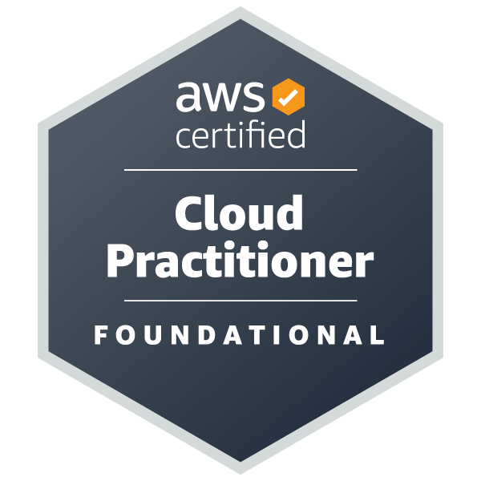
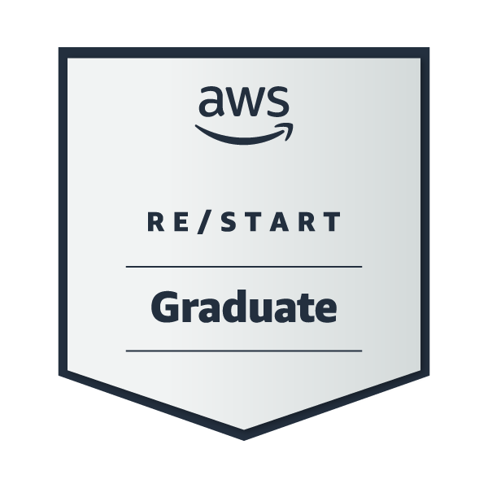

<h1 align="center">Hi 👋, I'm Vincent Sithole</h1>
<h3 align="center">IT Professional | AWS & Azure Certified | Aspiring Cloud & DevOps Engineer</h3>

   

---

### 💡 Professional Summary
I am an IT professional and a graduate of the AWS Re/Start program, bringing a unique background in installing alarm systems for ATMs and commercial buildings to the world of Cloud Computing. I hold the AWS Cloud Practitioner and Microsoft AZ-900 certifications. 

I believe the best way to master IT is to break things, fix them, and document the process. That is why I use my GitHub to host my **Helpdesk Simulations**, **Active Directory Labs**, and **AWS Cloud Deployments**. I am currently seeking a Helpdesk/IT Support or Junior Cloud role where I can apply my troubleshooting skills and continue my journey toward becoming a Cloud Engineer.

---

### 🛠️ Core Competencies
*   **Cloud:** AWS (EC2, VPC, S3, IAM, Route 53), Microsoft Azure
*   **Operating Systems:** Linux (Debian/Ubuntu), Windows Server
*   **Networking:** TCP/IP, DNS, Subnets, Route Tables, SSH
*   **Tools:** Git, GitHub, Bash, Python

<h3 align="left">Connect with me:</h3>

<h3 align="left">Languages and Tools:</h3>

 
<!-- Using solid color badges so they are visible on both light/dark modes -->

<h3 align="left">🚀 Featured Projects & Experience:</h3>

*   ☁️ **[AWS Cloud Infrastructure Lab](https://github.com/VincentSithole/AWS-Re-Start-Journey):** 
    *   Designed and deployed a fully functional Custom VPC from scratch.
    *   Configured public and private subnets, Internet Gateways, and optimized Route Tables for secure traffic flow.
    *   Launched and managed EC2 instances for hosting applications.
    *   Deployed a **Static Website** using AWS S3 and configured IAM policies for secure access.
    *   Built an interactive **AI Chatbot using Amazon Lex** to understand conversational interfaces.

*   🎫 **[IT Support Ticket Simulations](https://github.com/VincentSithole/IT-Support):** 
    *   Documenting realistic troubleshooting scenarios from a Tier 1 Helpdesk perspective (Network Printers, DNS, Active Directory).

*   🏢 **Microsoft Active Directory Lab:** 
    *   Simulating enterprise user lifecycle management (creating users, resetting passwords, managing Organizational Units).

*   🐧 **Local Home Lab:** 
    *   Running a Debian server with Samba (file sharing), Pi-hole (network-wide DNS), and Plex.

 

  

  

### 🏅 Certifications

| Microsoft Azure Fundamentals | AWS Cloud Practitioner | AWS re/Start Graduate |
| :---: | :---: | :---: |
|  |  |  |
